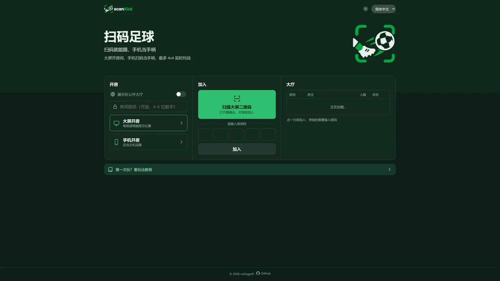

<p align="center">
  <picture>
    <source media="(prefers-color-scheme: dark)" srcset="public/brand/logo-dark.png">
    
  </picture>
</p>

<p align="center">
  <b>大屏开房，手机扫码当手柄，最多 4v4 实时对战的多人足球。</b><br>
  无需安装 App，无需后端服务器，打开网页就能踢。
</p>

<p align="center">
  <a href="https://github.com/noSugarK/scankick/stargazers"></a>
  <a href="https://github.com/noSugarK/scankick/actions/workflows/deploy.yml"></a>
  <a href="https://github.com/noSugarK/scankick/commits/main"></a>
  
</p>

<p align="center">
  <a href="https://nosugark.github.io/scankick/"><b>立即开玩</b></a> ·
  <a href="https://nosugark.github.io/scankick/#/guide">玩法教程</a> ·
  <a href="https://www.bilibili.com/video/BV1gfJf6iEEY/">宣传片</a> ·
  简体中文 · <a href="README.en.md">English</a>
</p>

<p align="center">
  
</p>

## 宣传片

<p align="center">
  <a href="https://www.bilibili.com/video/BV1gfJf6iEEY/"></a><br>
  <sub>点击封面，在 B 站观看 18 秒宣传片</sub>
</p>

## 亮点

<table>
  <tr>
    <td width="50%" valign="top">
      <br>
      <b>扫码即入场</b><br>
      电视或电脑开房，大屏显示二维码，所有人用手机一扫就加入；也能保存带 logo 的二维码卡片发给朋友。
    </td>
    <td width="50%" valign="top">
      <br>
      <b>大屏看比赛</b><br>
      主机运行 60Hz 物理，手机做本地预测，按下摇杆立即响应；人不齐时 AI 自动补位，三档难度可选。
    </td>
  </tr>
</table>

<table>
  <tr>
    <td width="22%" align="center" valign="top">
      <br>
      <sub>开房 / 加入 / 大厅，深浅主题</sub>
    </td>
    <td width="22%" align="center" valign="top">
      <br>
      <sub>公开大厅，可加 4–6 位密码</sub>
    </td>
    <td width="56%" align="center" valign="top">
      <br>
      <sub>没有大屏？一台手机就能当主机，边开房边踢</sub>
    </td>
  </tr>
</table>

- **两种开房方式**：大屏只负责显示，或者一台手机兼任主机和球员。
- **公开大厅与密码**：房间可以选择展示在大厅；扫二维码会自动带上密码。
- **扫码加入**：可以直接用摄像头扫，也可以从相册选二维码截图，还能手输 5 位房间码。
- **三种语言**：简体中文、繁體中文、English；首页支持浅色和深色主题。

## 快速开始

1. 在电视或电脑上打开 **[nosugark.github.io/scankick](https://nosugark.github.io/scankick/)**，选择「开房 → 大屏开房」。
2. 每个人用手机扫大屏上的二维码，起个昵称，选好队伍。
3. 横过手机，等房主点「开始比赛」。

没有大屏的话，在手机上选「开房 → 手机开房」，其他人扫这台手机屏幕上的二维码。

## 操作

| 按键 | 动作 | 说明 |
|:---:|---|---|
| 左摇杆 | 移动 | 在左半屏任意位置按下即出现 |
| **A** | 传球 | 传给朝向扇区内最合适的队友，没有队友则向前推球 |
| **B** | 射门 | 按住蓄力，松开射门，蓄满约 0.85 秒 |
| **X** | 冲刺 | 按住加速，消耗体力 |
| **Y** | 铲球 | 向前铲断，命中会让对手短暂倒地，有冷却 |

<details>
<summary><b>房主、投降与结束比赛</b></summary>

- **房主**：只有房主能开始比赛、调整设置和增减 AI。手机开房时房主是开房的那台手机；大屏开房时是最早加入的玩家，掉线后自动交给下一位，大屏本身也可以开始比赛。
- **投降**：比赛中点「菜单 → 投降」。本队在线真人**严格过半**同意即判负（1 人需 1 票，2 人需 2 票，3 人需 2 票，4 人需 3 票），再点一次可撤回。
- **房主结束**：大屏右上角「结束比赛」（或按 Esc），手机开房时在主机手机的菜单里，按当前比分判定胜负。
- **电脑调试**：WASD / 方向键移动，J 传球，K / 空格射门，L / Shift 冲刺，I 铲球。

</details>

<details>
<summary><b>公开大厅与房间密码</b></summary>

- 开房前打开「展示在公开大厅」，首页「大厅」页会实时列出房间人数、是否在比赛、是否加锁；主机关闭或掉线后自动消失。
- 密码为 4–6 位数字。扫二维码会自动带上密码；从大厅或手输房间码加入时需要输入。错误尝试全局限速（10 秒最多 5 次）。

</details>

<details>
<summary><b>开发者说明</b></summary>

#### 工作原理

- **主机**（大屏，或手机开房时的那台手机，见 `src/game/host-game.ts`）：运行 60Hz 物理和比赛逻辑，以 30Hz 向所有手机广播二进制状态快照，8 人约 115 字节每帧。
- **手机**：以 30Hz 上传输入；画面做快照插值，自己的球员做本地预测。
- **连接**：通过公共 MQTT（EMQX，国内可访问）交换 WebRTC 信令，建立 P2P DataChannel 直连；直连失败时自动回退到 MQTT 中继，并每 15 秒尝试恢复直连。公开大厅用 MQTT 保留消息实现，见 `src/net/lobby.ts`。

#### 本地开发

```bash
npm install
npm run dev        # HTTPS，局域网内手机可扫码访问（首次需信任自签名证书）
```

大屏用 `localhost` 打开时，二维码会自动换成本机局域网 IP。手机地址后加 `?relay`（如 `#/join/ABCDE?relay`）可强制走中继。

#### 部署到 GitHub Pages

1. 推送到 GitHub 仓库的 `main` 分支。
2. 仓库 Settings → Pages → Source 选择 **GitHub Actions**，并勾选「Enforce HTTPS」（摄像头扫码需要 HTTPS）。
3. 之后每次推送会自动构建发布，访问 `https://<用户名>.github.io/<仓库名>/`。

#### 网络配置（`src/config.ts`）

- `brokers`：信令服务器，按顺序尝试。
- `iceServers`：默认使用小米、B 站的 STUN。如果有玩家用 4G 经常显示「中继」，建议在国内云服务器上自建 coturn 并填入 TURN 配置，中继延迟会从秒级降到几十毫秒。

#### 已知限制

- 大屏页面必须保持在前台，切到后台浏览器会暂停计时器，比赛会停住。
- 公共 MQTT 主题是公开的，适合聚会娱乐。房间密码只能挡住大厅里的陌生人，挡不住监听 broker 的人（密码随 hello 明文发送）；正式使用建议换成带鉴权的 EMQX Serverless 或自建 broker。
- iOS Safari 不支持震动和网页全屏。

</details>

<p align="center"><sub>© 2026 noSugarK · 截图中的比赛为 AI 演示，大厅房间为演示数据</sub></p>
