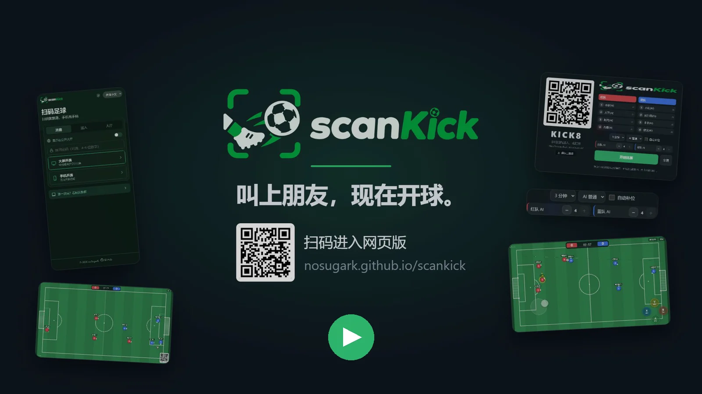
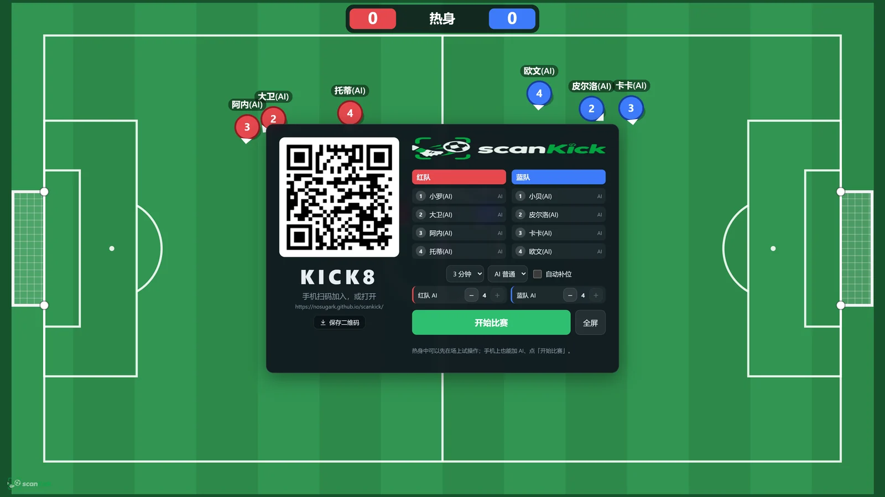
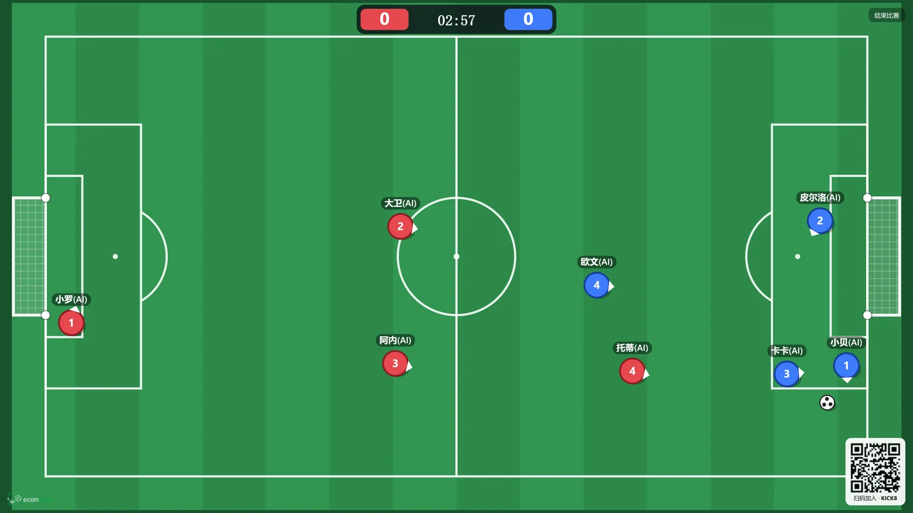
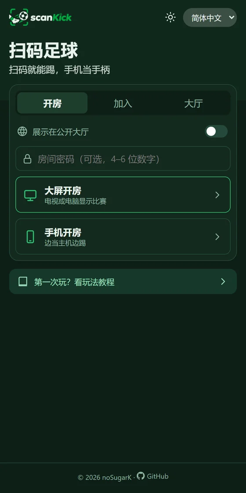
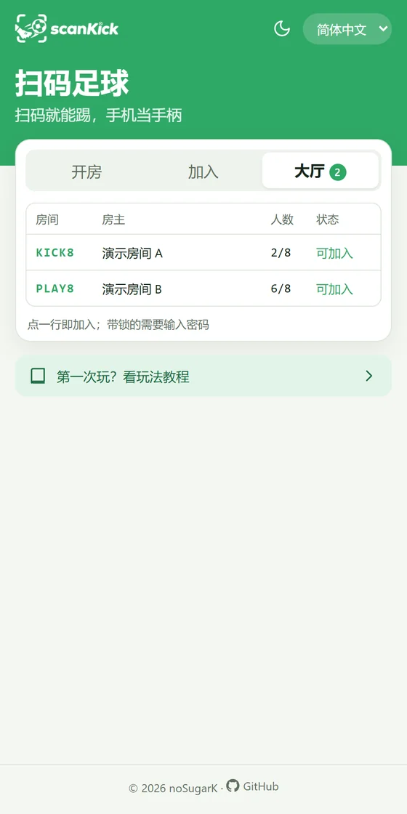
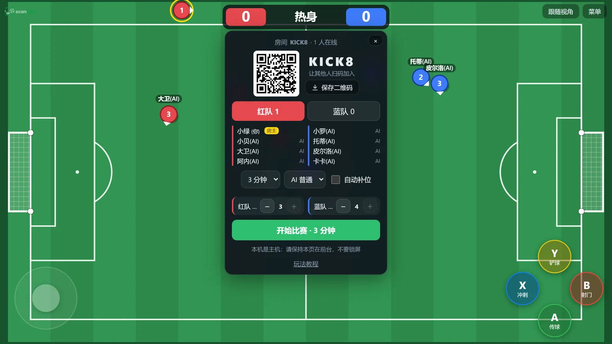

<p align="center">
  <picture>
    <source media="(prefers-color-scheme: dark)" srcset="public/brand/logo-dark.png">
    
  </picture>
</p>

<p align="center">
  <b>开踢 · ScanKick</b><br>
  <b>大屏开房，手机扫码当手柄，最多 4v4 实时对战的多人足球。</b><br>
  无需后端服务器，打开网页就能踢；也提供 Windows / macOS / Linux / Android 应用，支持断网局域网对战。
</p>

<p align="center">
  <a href="https://github.com/noSugarK/scankick/stargazers"></a>
  <a href="https://github.com/noSugarK/scankick/actions/workflows/deploy.yml"></a>
  <a href="https://github.com/noSugarK/scankick/commits/main"></a>
  
  <br>
  <a href="https://github.com/noSugarK/scankick/releases"></a>
  <a href="https://github.com/noSugarK/scankick/releases"></a>
  <a href="https://github.com/noSugarK/scankick/actions/workflows/release-app.yml"></a>
  
</p>

<p align="center">
  <a href="https://nosugark.github.io/scankick/"><b>立即开玩</b></a> ·
  <a href="https://nosugark.github.io/scankick/#/guide">玩法教程</a> ·
  <a href="#下载应用">下载应用</a> ·
  <a href="https://www.bilibili.com/video/BV1gfJf6iEEY/">宣传片</a> ·
  简体中文 · <a href="README.en.md">English</a>
</p>

## 宣传片

<p align="center">
  <a href="https://www.bilibili.com/video/BV1gfJf6iEEY/"></a><br>
  <sub>点击封面，在 B 站观看 18 秒宣传片</sub>
</p>

## 亮点

<table>
  <tr>
    <td width="50%" valign="top">
      <br>
      <b>扫码即入场</b><br>
      电视或电脑开房，大屏显示二维码，所有人用手机一扫就加入；也能保存带 logo 的二维码卡片发给朋友。
    </td>
    <td width="50%" valign="top">
      <br>
      <b>大屏看比赛</b><br>
      主机运行 60Hz 物理，手机做本地预测，按下摇杆立即响应；人不齐时 AI 自动补位，三档难度可选。
    </td>
  </tr>
</table>

<table>
  <tr>
    <td width="22%" align="center" valign="top">
      <br>
      <sub>开房 / 加入 / 大厅，深浅主题</sub>
    </td>
    <td width="22%" align="center" valign="top">
      <br>
      <sub>公开大厅，可加 4–6 位密码</sub>
    </td>
    <td width="56%" align="center" valign="top">
      <br>
      <sub>没有大屏？一台手机就能当主机，边开房边踢</sub>
    </td>
  </tr>
</table>

- **两种开房方式**：大屏只负责显示，或者一台手机兼任主机和球员。
- **公开大厅与密码**：房间可以选择展示在大厅；扫二维码会自动带上密码。
- **扫码加入**：可以直接用摄像头扫，也可以从相册选二维码截图，还能手输 5 位房间码。
- **三种语言**：简体中文、繁體中文、English；首页支持浅色和深色主题。

## 快速开始

1. 在电视或电脑上打开 **[nosugark.github.io/scankick](https://nosugark.github.io/scankick/)**，选择「开房 → 大屏开房」。
2. 每个人用手机扫大屏上的二维码，起个昵称，选好队伍。
3. 横过手机，等房主点「开始比赛」。

没有大屏的话，在手机上选「开房 → 手机开房」，其他人扫这台手机屏幕上的二维码。

## 下载应用

网页版打开即玩，玩家永远不需要安装任何东西。想在没有外网的地方开局域网房间，或在安卓上横屏全屏游玩，可以安装应用。
安装包在 [GitHub Releases](https://github.com/noSugarK/scankick/releases)，网页版右上角的下载按钮也会列出最新版本。

| 系统 | 安装包 | 要求与说明 |
|---|---|---|
| Windows | `.exe`（推荐）/ `.msi` | Windows 10 / 11 x64；缺少 WebView2 时安装程序会自动补装 |
| macOS | `.dmg` | Intel 与 Apple Silicon 通用，macOS 10.13+ |
| Linux | `.deb` / `.rpm` | x64，在 Ubuntu 22.04 上构建，需要 glibc 2.35+ 与 WebKitGTK 4.1 |
| Android | `.apk` | ARM64，Android 7.0+ |
| iOS / iPadOS | 暂不提供 | 用系统相机扫码，在浏览器里当手柄；想全屏可「分享 → 添加到主屏幕」后从图标打开 |

- **在线模式**：与网页版共用公开大厅和房间，二维码指向网页版，玩家扫码后直接在浏览器里加入。
- **局域网模式**：开房设备启动 HTTP/WebSocket 服务，无需外网；同一 Wi-Fi 或热点内，玩家可在应用大厅搜索并加入，也可扫码用浏览器加入。
- **安卓**：竖屏保留系统状态栏，横屏自动全屏；扫码时请求相机权限；外部链接用系统浏览器打开。

版本号带 `-` 的（如 `v0.1.0-beta.2`）是预发布版本。安装包暂未做发行者签名：Windows 可能出现 SmartScreen 提示（点「更多信息 → 仍要运行」），macOS 首次打开需在「系统设置 → 隐私与安全性」中允许；测试签名的 APK 应用 ID 带 `.debug`，不保证能覆盖升级。

## 操作

| 按键 | 动作 | 说明 |
|:---:|---|---|
| 左摇杆 | 移动 | 在左半屏任意位置按下即出现 |
| **A** | 传球 | 传给朝向扇区内最合适的队友，没有队友则向前推球 |
| **B** | 射门 | 按住蓄力，松开射门，蓄满约 0.85 秒 |
| **X** | 冲刺 | 按住加速，消耗体力 |
| **Y** | 铲球 | 向前铲断，命中会让对手短暂倒地，有冷却 |

## 比赛模式与派对规则

房主可在开赛前的设置中选择，比赛中不能更改；大屏和手机房主使用同一套设置。

| 模式 | 胜负条件 |
|---|---|
| 经典计时 | 按所选时长比赛，到时比分高者获胜，平分则为平局 |
| 抢三球 | 不限时，先打进 3 球的一队获胜 |
| 金球制 | 按所选时长比赛；到时平分则保留比分并重新开球，下一球决胜 |

每局还可搭配一种派对规则：**巨型足球**（直径翻倍，碰撞与出脚范围同步调整）、**无限体力**（冲刺不耗体力）或**强反弹**（足球减速更慢，边界和门柱反弹更强）。选「无」使用标准规则，比赛画面会显示当前启用的规则。

<details>
<summary><b>房主、投降与结束比赛</b></summary>

- **房主**：只有房主能开始比赛、调整设置和增减 AI。手机开房时房主是开房的那台手机；大屏开房时是最早加入的玩家，掉线后自动交给下一位，大屏本身也可以开始比赛。房主和大屏可以在名单里向左滑动某个玩家，可以转让房主（需二次确认）或移出房间（被移出的人本局内无法再加入）。
- **投降**：比赛中点「菜单 → 投降」。本队在线真人**严格过半**同意即判负（1 人需 1 票，2 人需 2 票，3 人需 2 票，4 人需 3 票），再点一次可撤回。
- **房主结束**：大屏右上角「结束比赛」（或按 Esc），手机开房时在主机手机的菜单里，按当前比分判定胜负。
- **电脑调试**：WASD / 方向键移动，J 传球，K / 空格射门，L / Shift 冲刺，I 铲球。

</details>

<details>
<summary><b>公开大厅与房间密码</b></summary>

- 开房前打开「展示在公开大厅」，首页「大厅」页会实时列出房间人数、是否在比赛、是否加锁；主机关闭或掉线后自动消失。
- 密码为 4–6 位数字。扫二维码会自动带上密码；从大厅或手输房间码加入时需要输入。错误尝试全局限速（10 秒最多 5 次）。

</details>

<details>
<summary><b>开发者说明</b></summary>

#### 工作原理

- **主机**（大屏，或手机开房时的那台手机，见 `src/game/host-game.ts`）：运行 60Hz 物理和比赛逻辑，以 30Hz 向所有手机广播二进制状态快照，8 人 124 字节每帧。
- **手机**：以 30Hz 上传输入；画面做快照插值，自己的球员做本地预测。
- **连接**：通过公共 MQTT（EMQX，国内可访问）交换 WebRTC 信令，建立 P2P DataChannel 直连；直连失败时自动回退到 MQTT 中继，并每 15 秒尝试恢复直连。公开大厅用 MQTT 保留消息实现，见 `src/net/lobby.ts`。

#### 本地开发

```bash
npm install
npm run dev        # HTTPS，局域网内手机可扫码访问（首次需信任自签名证书）
npm test           # 物理与输入回归测试（Node.js 22.15+ 或 24 LTS）
```

大屏用 `localhost` 打开时，二维码会自动换成本机局域网 IP。手机地址后加 `?relay`（如 `#/join/ABCDE?relay`）可强制走中继。

输入协议使用 32 位序号过滤旧包和重复包。按键变化立即发送，直连输入使用可靠有序通道，中继输入使用 MQTT QoS 1；主机逐帧处理按下和松开，快照仍通过原来的低延迟通道发送。当前协议 v3 在快照中同步比赛模式、金球阶段与派对规则，与旧页面隔离；更新后主机和手机都需要刷新页面并重新开房加入。

#### Tauri 应用开发（实验中）

网页与应用共享 `src/` 和 `public/`，原生入口及配置位于 `src-tauri/`。
应用首页可选择「在线模式」或「局域网模式」。在线模式沿用 MQTT/WebRTC；局域网模式由 Rust 提供本地 HTTP/WebSocket 服务，复用现有主机比赛逻辑，不连接公共大厅、MQTT 或 STUN。

局域网玩法：

1. 主机与玩家连接同一 Wi-Fi，或手动开启主机热点并让玩家连接。
2. App 选择「局域网模式」，再选择大屏或手机开房，可设置房间密码。
3. 玩家 App 选择「局域网模式 → 大厅」，自动搜索并点击主机房间加入，无需自己开房。未发现时可输入主机入场地址和房间码，或粘贴完整邀请链接。
4. 不安装 App 的玩家仍可用系统相机扫描主机二维码，在浏览器加入；主机在地址列表中选择玩家能访问的网卡。
5. 主机保持应用前台、屏幕常亮；退出房间会关闭本地服务。重新开房后需重新搜索或扫码。

大厅通过 UDP 42819 搜索房间，每隔约 6 秒刷新；游戏走主机动态端口上的 WebSocket。有多个网卡时不要选择 VPN/虚拟网卡。Windows 若弹出防火墙提示，需允许应用在实际使用的网络上接收连接；带客户端隔离的访客 Wi-Fi 可能无法互联。UDP 广播被屏蔽时可尝试手动地址加入。
浏览器玩家使用局域网 HTTP 页面，网页摄像头、自动常亮等能力可能不可用，请使用系统相机扫码并手动避免锁屏。
自动开启热点、手机后台持续比赛尚未支持；暂不提供 iOS 应用。

已安装 Rust、Tauri CLI 和对应平台构建工具后：

```bash
npm ci
npm run app:dev      # 启动 Vite 和原生窗口
npm run app:build    # 构建当前桌面平台安装包
cargo test --manifest-path src-tauri/Cargo.toml --lib  # 本地 HTTP/WebSocket 集成测试
```

应用开发时先构建一份供玩家下载的静态资源，再启动 `http://127.0.0.1:1420`，端口占用时直接报错；修改页面后需重新启动应用开发命令，刷新内嵌的玩家资源。`npm run dev` 继续提供原有的 HTTPS 网页开发服务。
Windows 需要 MSVC Build Tools 和 WebView2；macOS/iOS 需要 Mac 和 Xcode，Android 需要另行安装 SDK/NDK，并执行 `cargo tauri android init` 生成平台工程。
Android 开发入口为 `cargo tauri android dev`，构建入口为 `cargo tauri android build`；移动端需要根据设备配置开发服务器可达地址。
现有 GitHub Pages 工作流继续独立部署网页。

#### 应用安装包（GitHub Actions）

工作流 `Build app installers` 支持手动运行，也会在推送 `v*` 标签时自动构建。普通分支手动运行后，在该次 Actions 的 Artifacts 中下载；标签构建全部成功后自动创建或更新 GitHub Release。

| 平台 | 安装包命名示例 |
| --- | --- |
| Windows x64 | `ScanKick_0.1.0_windows-x64.exe`、`ScanKick_0.1.0_windows-x64.msi` |
| macOS Intel / Apple Silicon 通用版 | `ScanKick_0.1.0_macos-universal.dmg` |
| Linux x64 | `ScanKick_0.1.0_linux-x64.deb`、`ScanKick_0.1.0_linux-x64.rpm` |
| Android ARM64 | `ScanKick_0.1.0_android-arm64.apk`，未配置正式签名时带 `-test-signed` 后缀 |

只上传以上安装包，不上传 AppImage、裸可执行文件、`.app` 目录、AAB 或构建目录。Actions 下载归档保留 14 天；GitHub Release 自带的源码下载链接由 GitHub 自动提供。
Android SDK/NDK 和安卓工程在 CI 中自动准备，不要求本机预先生成安卓工程；本机 `npm run app:build` 仍只构建当前桌面平台。

发布前保持 `package.json`、`src-tauri/tauri.conf.json`、`src-tauri/Cargo.toml` 中的版本一致，提交代码后打对应标签，例如：

```bash
git tag v0.1.0
git push origin v0.1.0
```

版本号含 `-` 的标签（如 `v0.1.0-beta.1`、`v1.0.0-rc.1`）创建预发布版本，否则为正式版本；标签必须与应用版本一致。新工作流尚未进入默认分支时，网页可能不显示手动运行入口；向包含该工作流的提交推送标签仍可触发。

MSI 内部版本只接受数字：`bundle.windows.wix.version` 应设为去掉预发布后缀的版本（例如 `0.1.0`），CI 会检查一致性；下载文件名仍保留完整的 `0.1.0-beta.2` 等版本。

Android 始终使用 Release 优化编译并移除 Rust 调试符号。推送版本标签或手动构建标签时，必须配置固定签名密钥；缺少或只配置部分签名 Secrets 会在构建开始时失败，避免发布无法稳定覆盖升级的测试包。仅在分支上手动构建时允许不配置签名，此时使用临时测试密钥，应用 ID 保留 `.debug` 后缀，不保证覆盖升级，也不应作为发布安装包。请在仓库 Settings → Secrets and variables → Actions 配置下面四个 Secrets：

- `ANDROID_KEYSTORE_BASE64`：签名 keystore 文件的 Base64，使用不换行的编码。
- `ANDROID_KEYSTORE_PASSWORD`：keystore 密码。
- `ANDROID_KEY_ALIAS`：签名密钥别名。
- `ANDROID_KEY_PASSWORD`：签名密钥密码。

配置齐全后自动构建正式签名 APK；后续版本务必沿用并备份同一份密钥，签名文件只写入临时目录，构建后清理。此前安装过 `test-signed` APK 的用户需要卸载测试版后再安装固定签名版本，卸载会清除应用本地数据；完成这次迁移后，同包名、同签名且版本号递增的版本才可以覆盖升级。Windows/macOS 目前未配置发行者签名或 Apple 公证，首次安装可能显示系统校验提示。

#### 部署到 GitHub Pages

1. 推送到 GitHub 仓库的 `main` 分支。
2. 仓库 Settings → Pages → Source 选择 **GitHub Actions**，并勾选「Enforce HTTPS」（摄像头扫码需要 HTTPS）。
3. 之后每次推送会自动构建发布，访问 `https://<用户名>.github.io/<仓库名>/`。

#### 网络配置（`src/config.ts`）

- `brokers`：信令服务器，按顺序尝试。
- `iceServers`：默认使用小米、B 站的 STUN。如果有玩家用 4G 经常显示「中继」，建议在国内云服务器上自建 coturn 并填入 TURN 配置，中继延迟会从秒级降到几十毫秒。

#### 已知限制

- 大屏页面必须保持在前台，切到后台浏览器会暂停计时器，比赛会停住。
- 公共 MQTT 主题是公开的，适合聚会娱乐。房间密码只能挡住大厅里的陌生人，挡不住监听 broker 的人（密码随 hello 明文发送）；正式使用建议换成带鉴权的 EMQX Serverless 或自建 broker。
- iOS / iPadOS 不支持震动和网页全屏。iOS 上的 Chrome、Edge 等浏览器同样使用 Safari 内核，换浏览器无法解决；添加到主屏幕后从图标打开可以全屏。

</details>

<p align="center"><sub>© 2026 noSugarK · 截图中的比赛为 AI 演示，大厅房间为演示数据</sub></p>
